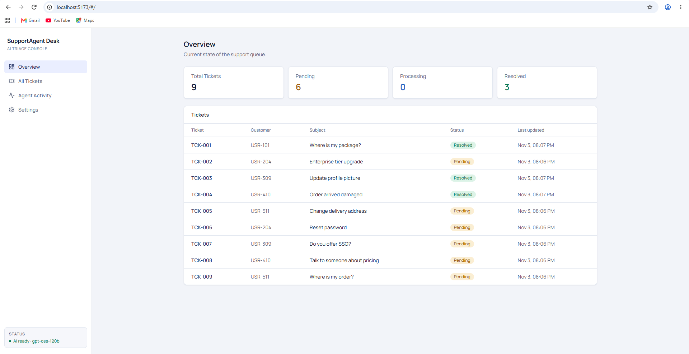
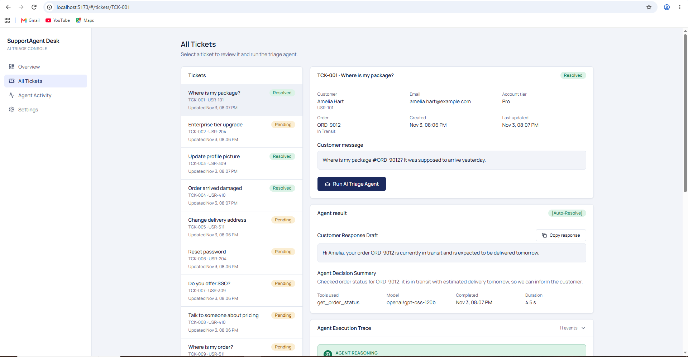
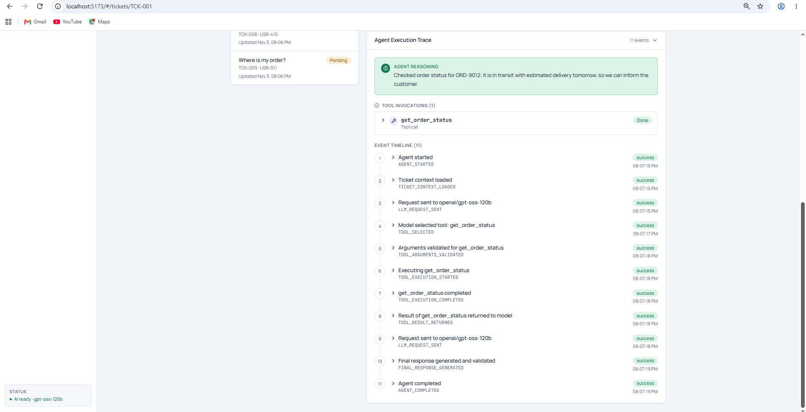
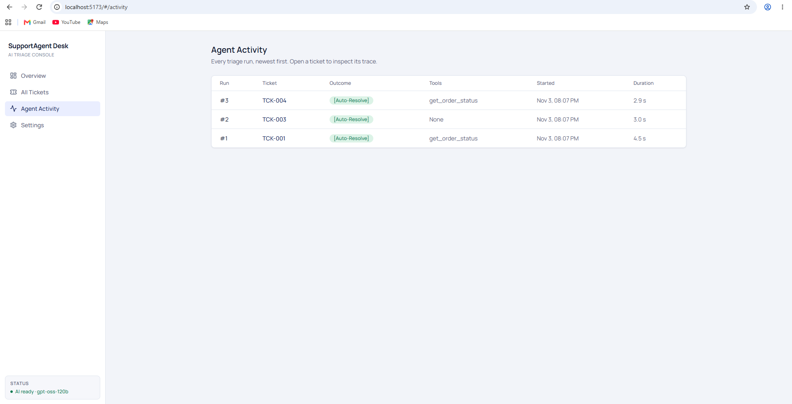

# SupportAgent Desk

## Prerequisites

Make sure you have the following installed:

- **Node.js**
- **Python**
- **Git**
- **Groq API Key**

## Installation & Setup

### 1. Clone the Repository

```bash
git clone THIS_GITHUB_REPOSITORY_URL
cd supportagent-desk
```

### 2. Install Dependencies

```bash
npm run install:all
```

### 3. Configure Environment Variables

Inside the `backend` folder, create a new file named **`.env`**.

Copy and paste the following configuration into `backend/.env`:

```env
# --- AI provider: Groq (free, no credit card) ---
GROQ_API_KEY=
GROQ_MODEL=openai/gpt-oss-120b
GROQ_FALLBACK_MODEL=openai/gpt-oss-20b
GROQ_BASE_URL=https://api.groq.com/openai/v1

# --- App ---
DATABASE_URL=sqlite:///./supportagent.db
BACKEND_HOST=127.0.0.1
BACKEND_PORT=8000
FRONTEND_URL=http://localhost:5173
MAX_AGENT_ITERATIONS=5
```

**Get your Groq API Key:**

1. Visit [Groq Console](https://console.groq.com/keys).
2. Generate a new API key.
3. Copy the generated key.
4. Paste it after `GROQ_API_KEY=` in your `backend/.env` file.

For example:

```env
GROQ_API_KEY=gsk_your_actual_api_key
```


```

### 4. Run the Application

From the project root directory, run:

```bash
npm run dev
```

The application will be available at:

- **Frontend:** http://localhost:5173
- **Backend API:** http://localhost:8000
- **API Documentation:** http://localhost:8000/docs

## Environment Variables

| Variable | Description | Default Value |
|---|---|---|
| `GROQ_API_KEY` | Groq API key | Required |
| `GROQ_MODEL` | Primary AI model | `openai/gpt-oss-120b` |
| `GROQ_FALLBACK_MODEL` | Fallback AI model | `openai/gpt-oss-20b` |
| `GROQ_BASE_URL` | Groq API endpoint | `https://api.groq.com/openai/v1` |
| `DATABASE_URL` | Database connection URL | `sqlite:///./supportagent.db` |
| `BACKEND_HOST` | Backend host | `127.0.0.1` |
| `BACKEND_PORT` | Backend port | `8000` |
| `FRONTEND_URL` | Frontend URL | `http://localhost:5173` |
| `MAX_AGENT_ITERATIONS` | Maximum agent iterations | `5` |

## Security Note

- Never commit your actual `.env` file.
- Keep your API key private.
- Use `.env.example` to document the required environment variables.


## Screenshots

### Overview


### All Tickets




### Agent Activity
